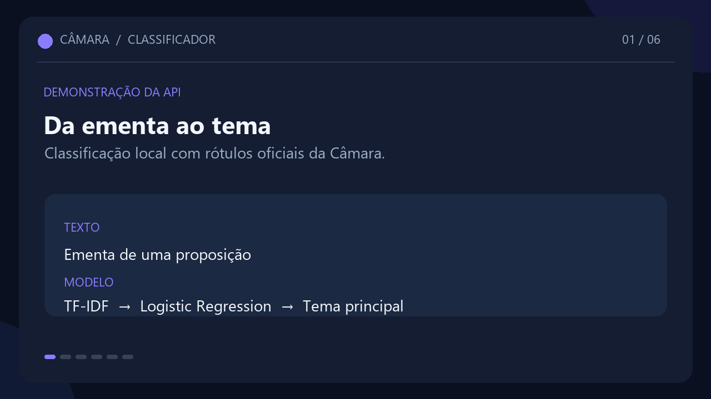
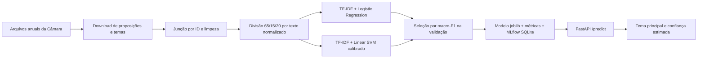

# Classificador de temas legislativos

> API que recebe a ementa de uma proposição e sugere o tema legislativo mais provável, com um modelo treinado nos rótulos oficiais da Câmara dos Deputados.

## Demo



- API local: `http://localhost:8000`
- Documentação interativa: `http://localhost:8000/docs`
- Endpoint de classificação: `POST /predict`
- Endpoint de saúde: `GET /health`

## Problema

Analistas e pessoas que pesquisam proposições podem usar a previsão como triagem inicial para localizar matérias por assunto.

O sistema recebe uma ementa e retorna um tema principal. Não substitui a classificação oficial da Câmara, não interpreta o mérito jurídico e não decide todos os temas secundários associados a uma proposição.

## Dados

| Item | Recorte usado neste relatório |
|---|---|
| Fonte | [Dados Abertos da Câmara dos Deputados](https://dadosabertos.camara.leg.br/) |
| Arquivos | Proposições anuais e classificações temáticas oficiais |
| Período | 2026 |
| Data da coleta local | 27/10/2026 |
| Proposições lidas | 46.904 |
| Com ementa e ao menos um tema | 11.084 |
| Temas oficiais encontrados | 32 |
| Temas selecionados para o modelo | 10 |
| Amostras do conjunto de treino/avaliação | 9.742 |
| Licença | A Câmara descreve os dados abertos como livres de restrições de licença; consulte a [orientação oficial](https://dadosabertos.camara.leg.br/howtouse/sobre-dados-abertos.html) e atribua a fonte. |

Os arquivos brutos não são incluídos no Git. O comando de download preserva os arquivos existentes:

```bash
python -m app.baixar_dados --inicio 2016 --fim 2026
```

Para criar o dataset e o resumo da coleta:

```bash
python -m app.dataset --top-classes 10 --min-samples 50
```

O preparo une proposições e temas pelo ID, normaliza espaços da ementa, elimina registros sem texto ou tema, elimina associações repetidas ao mesmo tema e interrompe a execução se um código oficial aparecer com nomes conflitantes. A distribuição abaixo é do conjunto de 2026 antes do filtro para as dez classes:

| Tema | Proposições rotuladas |
|---|---:|
| Direitos Humanos e Minorias | 3.090 |
| Administração Pública | 2.642 |
| Saúde | 2.077 |
| Finanças Públicas e Orçamento | 2.054 |
| Trabalho e Emprego | 1.402 |
| Defesa e Segurança | 1.351 |
| Educação | 1.237 |
| Comunicações | 1.210 |
| Economia | 1.011 |
| Indústria, Comércio e Serviços | 983 |

Os dados oficiais podem atribuir mais de um tema a uma proposição. O treino preserva esses rótulos; a API retorna o tema de maior pontuação.

## Arquitetura



## Treinar e avaliar

Depois de baixar e preparar os dados, um comando treina e compara os modelos:

```bash
python -m app.train
```

O treino mantém textos idênticos no mesmo conjunto, usa 65% para treino, 15% para validação e 20% para teste, e escolhe o modelo pela macro-F1 multilabel de validação. O teste fica reservado para a avaliação final. O MLflow grava em `outputs/mlruns/mlflow.db`.

Resultados medidos no conjunto de teste de 2026, com 1.946 proposições. A balanced accuracy é a média da balanced accuracy binária dos dez temas. Top‑1 mede se o tema de maior pontuação está entre os rótulos oficiais da proposição.

| Modelo | Macro-F1 validação | Macro-F1 teste | Balanced accuracy teste | Top‑1 teste | Selecionado |
|---|---:|---:|---:|---:|---|
| TF-IDF + Logistic Regression | 0,7259 | 0,7281 | 0,8459 | 0,8407 | Sim |
| TF-IDF + Linear SVM calibrado | 0,7068 | 0,7197 | 0,8078 | 0,8458 | Não |

Métricas por tema no teste:

| Tema | Suporte | Precisão | Recall | F1 | Balanced accuracy | Matriz TN/FP/FN/TP |
|---|---:|---:|---:|---:|---:|---|
| Direitos Humanos e Minorias | 575 | 0,707 | 0,812 | 0,756 | 0,835 | 1.177 / 194 / 108 / 467 |
| Administração Pública | 553 | 0,606 | 0,747 | 0,669 | 0,777 | 1.124 / 269 / 140 / 413 |
| Saúde | 408 | 0,862 | 0,814 | 0,837 | 0,890 | 1.485 / 53 / 76 / 332 |
| Finanças Públicas e Orçamento | 419 | 0,649 | 0,768 | 0,704 | 0,827 | 1.353 / 174 / 97 / 322 |
| Trabalho e Emprego | 256 | 0,703 | 0,738 | 0,720 | 0,845 | 1.610 / 80 / 67 / 189 |
| Defesa e Segurança | 293 | 0,684 | 0,812 | 0,743 | 0,873 | 1.543 / 110 / 55 / 238 |
| Educação | 212 | 0,886 | 0,840 | 0,862 | 0,913 | 1.711 / 23 / 34 / 178 |
| Comunicações | 232 | 0,846 | 0,828 | 0,837 | 0,904 | 1.679 / 35 / 40 / 192 |
| Economia | 200 | 0,543 | 0,720 | 0,619 | 0,825 | 1.625 / 121 / 56 / 144 |
| Indústria, Comércio e Serviços | 215 | 0,466 | 0,628 | 0,535 | 0,769 | 1.576 / 155 / 80 / 135 |

O relatório de treino também salva a matriz de confusão binária de cada tema, a comparação em CSV e uma amostra aleatória e reproduzível de até 30 erros em `outputs/`. A [análise manual da amostra](docs/analise-erros.md) descreve os padrões observados. Os artefatos gerados em `outputs/` e o modelo em `models/` não são versionados.

## Onde o modelo falha

Os erros aparecem principalmente quando a ementa mistura temas próximos, como economia e orçamento, ou quando o texto menciona órgãos públicos, mas o tema oficial é outro. Como o modelo estima cada tema separadamente e usa limiar 0,5 para as métricas multilabel, pode sugerir temas secundários a mais ou deixar de sugerir alguns rótulos oficiais. A confiança é uma probabilidade estimada pelo classificador, não garantia de acerto.

O resultado atual mede apenas proposições de 2026 com uma divisão aleatória por texto. Ele não demonstra generalização para outros anos; para isso, baixe outros períodos e faça também uma avaliação temporal.

## API

Instale as dependências, treine o modelo e inicie a API:

```bash
pip install -r requirements.txt
python -m uvicorn app.main:app --reload --port 8000
```

Exemplo de requisição:

```json
{"texto":"Dispõe sobre o acesso à educação básica nas escolas públicas."}
```

Resposta ilustrativa baseada na chamada local usada para a demonstração:

```json
{"tema":"Educação","confianca":0.9909}
```

`GET /health` retorna `model_ready: true` somente se o artefato puder ser carregado. Texto vazio ou acima de 20.000 caracteres é rejeitado pela validação da API.

## Docker

Depois de baixar os dados, preparar o dataset e treinar o modelo:

```bash
docker compose up --build api
```

A API fica em `http://localhost:8001`; a documentação interativa fica em `/docs`.

## Testes

```bash
python -m pytest -q tests
```

Os testes cobrem a junção e validação de rótulos, divisão sem vazamento de textos duplicados, treino e registro MLflow, validação da entrada e os endpoints da API.
